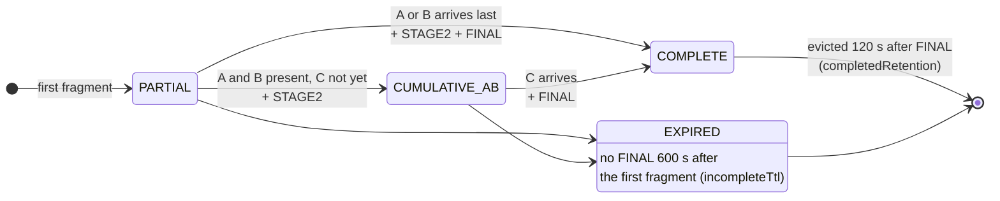
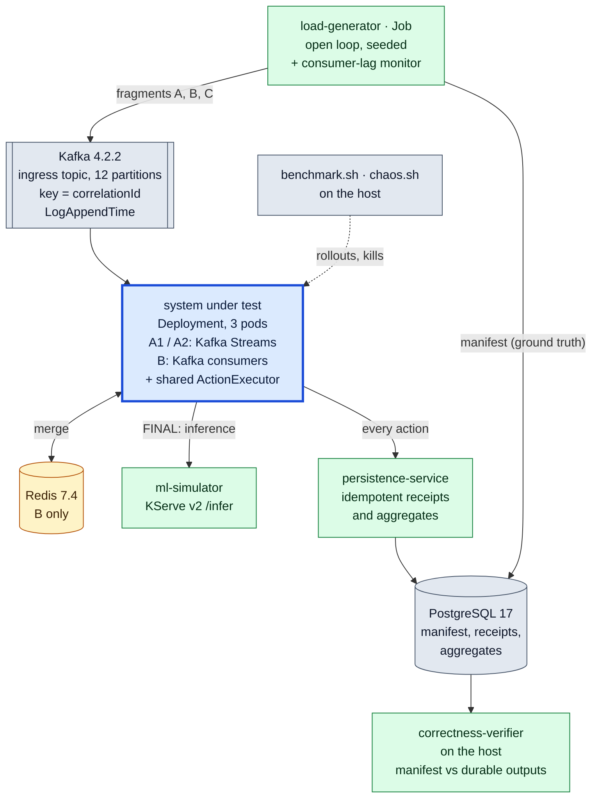
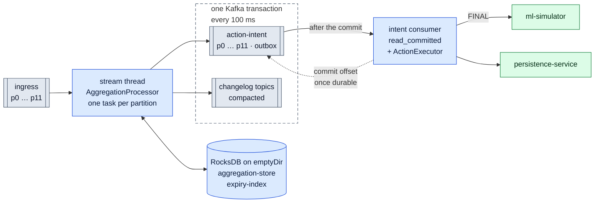
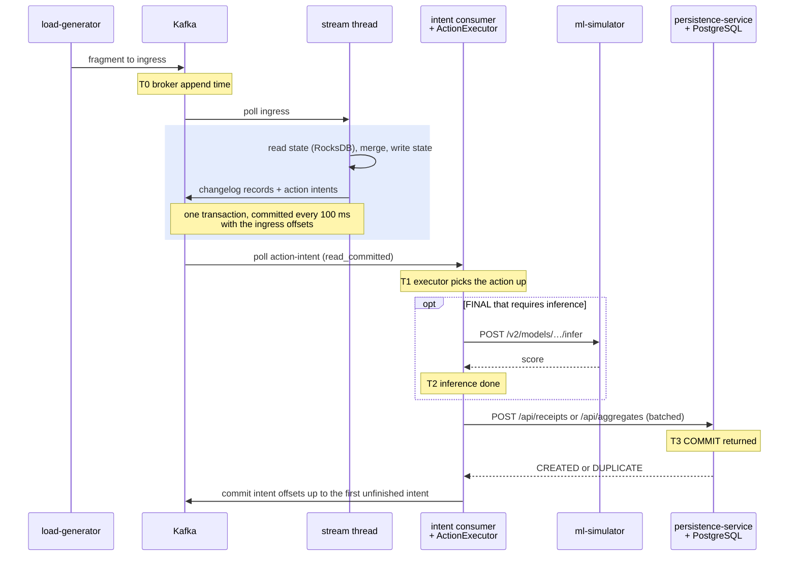
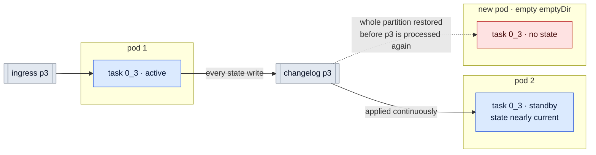
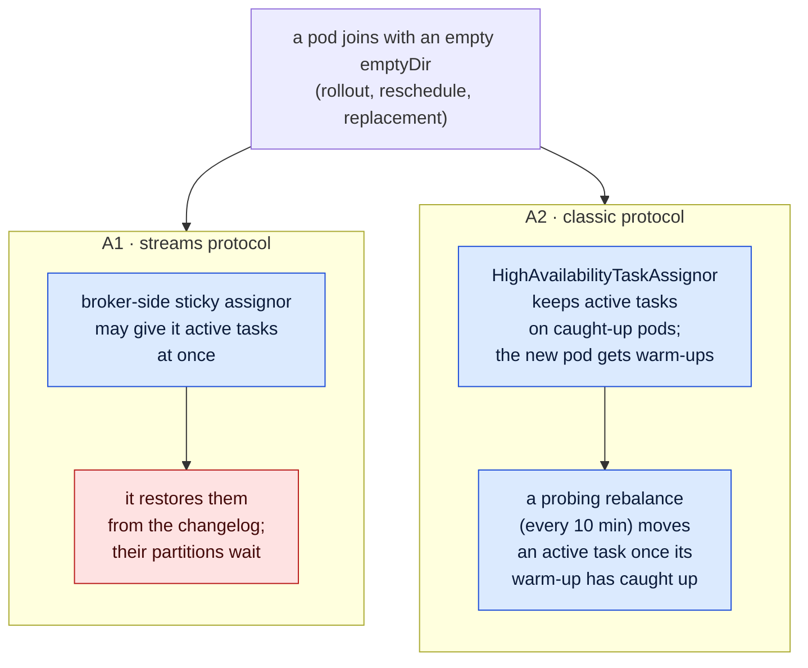
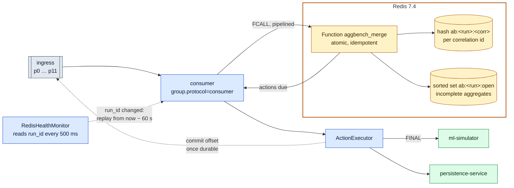
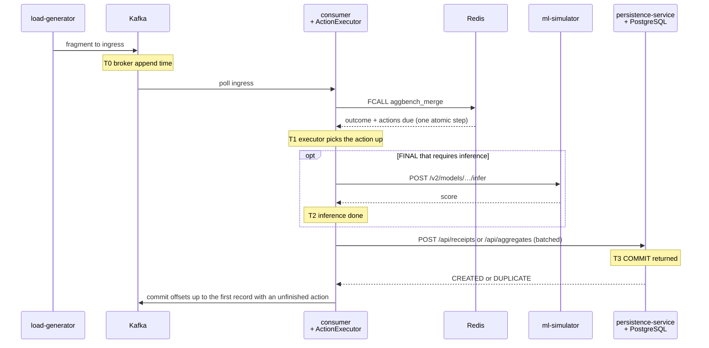
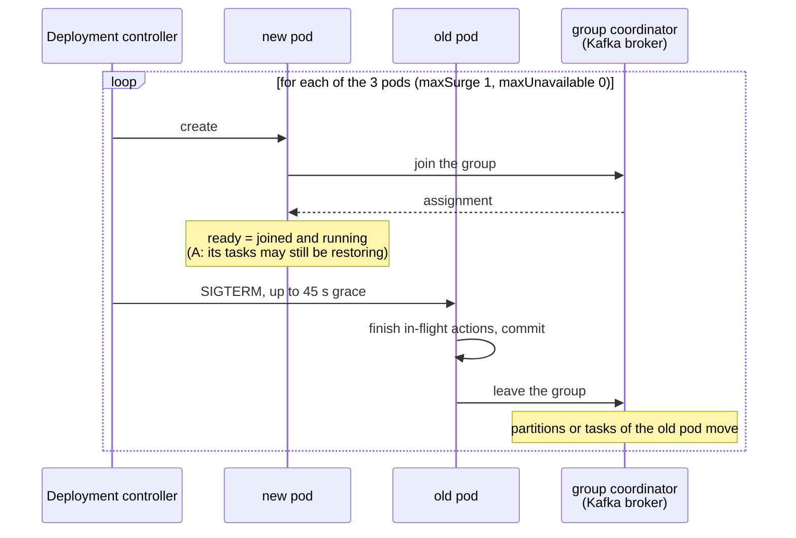

# Architecture

## Business flow (identical for every variant)

Three fragments share a `correlationId`; each carries disjoint information. Every fragment is actionable on its own:

| Arrival | Always | When the condition first holds |
|---|---|---|
| fragment A, B or C | **INDIVIDUAL** action for that fragment (durable receipt `I:<eventId>`) | — |
| A and B present | — | **STAGE2**: build the cumulative A+B representation, execute its action (receipt `S2:<corr>`) |
| A, B and C present | — | **FINAL**: build A+B+C, run ML inference (KServe v2), persist the aggregate (`F:<corr>`) |

The life of one aggregate. Every fragment except a duplicate or a stale version makes its own INDIVIDUAL
action due; the transitions show the actions that become due in addition:

Fragments may arrive in any order (with the last one, STAGE2 and FINAL can become due together), may be
duplicated, may come in stale versions, and may be missing (the aggregate stays incomplete and observable,
and when it expires it is counted, `INCOMPLETE_EXPIRED`, never persisted). A duplicate or stale delivery
changes nothing; a redelivered Kafka record re-issues exactly the actions it triggered the first time.
The rules are one pure state machine (`AggregationLogic`) implemented once in Java and once in Lua, tested
against the same fixtures.

## System overview

Blue is the system under test, the only part that differs between variants. Green is the measurement
environment, identical for every variant; amber is used by variant B only; grey is shared infrastructure and
the scripts on the host. The same colours are used in every diagram below. Prometheus and Grafana (not drawn)
watch every pod; no reported latency comes from them.

## A1 / A2 — Kafka Streams

Both halves run in every aggregator pod; the dashed box is what one transaction commits, together with the
ingress offsets:

One fragment's path, with the instants the verifier measures latency between:

T0 is the broker append time of the fragment (for STAGE2 and FINAL, the latest append time of the required
fragments). Aggregation-only latency is T0→T1; result ready is T0→T1, or T0→T2 for FINAL; end to end
is T0→T3 (`docs/BENCHMARK-METHODOLOGY.md`). In A, T1 already includes the wait for the transaction commit and
the extra Kafka hop.

- **Ownership**: one task per ingress partition. A task (and its state) is owned by exactly one active pod;
  with three pods and 12 partitions each pod owns ~4 active tasks and ~4 standby tasks.
- **State**: per correlation id an `AggregationState` (fragments, versions, record refs, stage flags) in RocksDB on
  the pod's `emptyDir`. Every write is also in the changelog topic, which is the durable copy.
- **Processing guarantee**: `exactly_once_v2`. State changelog writes, the forwarded action intents and the input
  offset commit are one Kafka transaction (every `commit.interval.ms` = 100 ms).
- **External side effects**: never called from the stream thread. Intents go to a transactional outbox topic;
  a separate consumer (same pod, `group.protocol=consumer`, `read_committed`) executes them and commits the
  intent offsets only after the action is durable. Cost: one extra Kafka hop + waiting for the EOS commit.
- **Standby replicas**: one per task. A1 configures them as a *group* config (`streams.num.standby.replicas=1`,
  set by `benchmark.sh`, verified by every pod); A2 as a *client* config (`num.standby.replicas=1`).
- **A1 vs A2**: identical image and topology. A1 uses the broker-side Streams rebalance protocol (KIP-1071; in 4.2
  only the sticky assignor, no warm-up tasks). A2 uses the classic protocol with the client-side
  HighAvailabilityTaskAssignor (warm-up tasks, probing rebalances every 10 min by default).
- **Recovery**: a task moving to a pod that already hosts its standby resumes almost immediately; a task moving to
  a pod without local state must restore its stores from the changelog before processing resumes.

Where a task can resume, shown for task `0_3` (red: a pod without the task's state):

If pod 1 goes, the cheap move is to pod 2, which only has to apply the last few changelog records. The two group
protocols differ in how often a task lands on a pod without state:

## B — Kafka consumers + Redis

Every aggregator pod is stateless; the state lives in Redis:

One fragment's path, with the same measurement instants as in A:

- **Ownership**: partitions are assigned by the broker (KIP-848, incremental). Pods are stateless; any pod can
  process any partition immediately after assignment because the state is in Redis.
- **State**: one Redis hash per correlation id, modified only by the `aggbench_merge` Redis Function (atomic,
  idempotent). Commands from a consumer are pipelined on one connection, so per-key order is the partition order.
- **Processing guarantee**: at-least-once with idempotent effects. Redelivery of the *same Kafka record*
  (same partition:offset) is recognised (`REDELIVERED`) and re-issues exactly the actions that record triggered.
- **External side effects**: executed directly by the consumer pod with the shared ActionExecutor; no outbox is
  needed because the offset is only committed after every action of the record is durable.
- **Redis durability**: AOF `appendfsync everysec` (local profile) or async replication + Sentinel (HA profile).
  Neither makes acknowledged writes strongly durable. Kafka is the source of truth: when a pod sees the Redis
  `run_id` change (restart or failover), it re-reads its partitions from `now − replayWindow` (default 60 s) and
  rebuilds lost state; see FAILURE-RECOVERY.md.

## Equivalent business guarantees

| Guarantee | A1/A2 | B |
|---|---|---|
| Fragment state change + "which actions are due" | atomic (EOS transaction) | atomic (Redis Function) |
| Action durably executed at least once | outbox + commit-after-completion | commit-after-completion |
| No duplicate durable business outcome | idempotency keys in PostgreSQL | idempotency keys in PostgreSQL |
| State survives pod loss | changelog (Kafka, durable) | Redis (not strongly durable) + Kafka replay |
| Ordering per correlation id | partition order | partition order (pipelined on one connection) |

## Kubernetes

- Applications are `Deployment`s (never StatefulSets), no PVCs; Kafka Streams state is an `emptyDir`
  (lost with the pod, kept across a container restart). Kafka, Redis, PostgreSQL and Prometheus use PVCs.
- Rolling updates `maxSurge: 1, maxUnavailable: 0`, `terminationGracePeriodSeconds: 45`, startup/readiness/
  liveness probes. Readiness = joined the group and running; per-task restoration is exposed separately
  (`/status`, metrics), never inferred from readiness.
- Group membership timing is the same for all protocols: session timeout 10 s, heartbeat 250 ms (ADR 0003).
- Downstream services (persistence, ML simulator) are redeployed with every run, identical for all variants.

A rollout of the three aggregator pods therefore changes the group membership six times: three joins and
three leaves. Within each step the new pod is ready before the old one is stopped; the old pod's shutdown can
overlap the next step:

